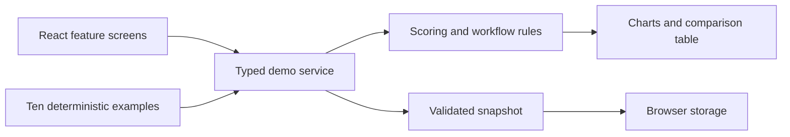

# OC AI · AI Registry

A working, browser-local AI governance playground. Explore ten fictional use cases, understand their risk, try an assessment and follow a review decision.

Built with React, TypeScript and the OC AI design template v1.2. All example records, dates, comments and activity are synthetic. There is no shared database, login, model API or telemetry.

## Run locally

Use Node.js 22.13 or newer (Node 24 LTS recommended) and npm.

```sh
npm ci
npm run dev
```

Open the local URL printed by Vite. The default is port 4173, bound to the loopback interface.

```sh
npm run check
npm run preview
```

`check` runs TypeScript, ESLint, the domain/storage tests and the production build. `preview` serves the built `dist` directory. Fonts and imagery are local assets; the production app makes no data requests.

## Try the product

1. Select the grouped dot in the risk map. Its number matches the cases in the preview.
2. Open Registry, filter by department and export the matching rows as CSV.
3. Continue the meeting-notes draft, answer the remaining question and submit it.
4. Switch to **Demo Reviewer**, open that case and record a decision with an explanation.
5. Switch to **Demo Administrator**, change the methodology thresholds and compare the current dashboard with the saved assessment evidence.
6. Use **Demo tools → Reset demo** to restore the original ten examples.

The registry stays a table on phones. Secondary fields move beneath the use case or into an expandable row detail. Chart selections and action menus float without blocking the page. Only risk and required-review states carry semantic colour; lifecycle labels stay neutral.

## Architecture



- `src/domain.ts`: shared schemas, score calculation, visibility, chart grouping and CSV generation.
- `src/store.ts`: versioned persistence, CRUD, reviews, history, reset and stale-write protection.
- `src/seed.ts`: deterministic synthetic examples; scores come from their answers.
- `src/ui.tsx`: reusable status labels, non-modal previews, information popovers and confirmation dialogs.
- Feature screens own their presentation and filter state. They call named service methods rather than a pretend HTTP backend.

See [product and architecture](docs/product-and-architecture.md), [verification](docs/verification.md) and [publication handoff](docs/publication-handoff.md).

## Demo boundaries

The illustrative score adds four 0–3 factors, with a maximum of 12. The default bands are Low 0–3, Medium 4–7 and High 8–12. Review flags are independent. This is not a validated risk model, legal guidance or compliance certification.

Role and visibility controls are simulations, not security boundaries. All local data can be inspected or edited with browser tools. Activity is demonstrative, not a tamper-proof audit trail. Do not enter confidential or personal data.

Reload preserves saved edits when browser storage is available. Private browser profiles have independent datasets. A stale-tab write is rejected rather than knowingly overwriting a newer snapshot. Simultaneous writes are not database transactions. When storage is unavailable, the app continues in memory and explains that changes last only for the session. Downloading local data creates a JSON backup; there is no JSON import feature.

Once loaded, interactions can continue offline. A fresh offline load is not supported: there is no service worker or installable PWA.

## Static hosting

The public demo is published at [imchuwy.github.io/app-ai-registry](https://imchuwy.github.io/app-ai-registry/). GitHub Pages uses the GitHub Actions publishing source. The workflow checks every branch and pull request; only a successful run on `main` uploads `dist/` and deploys it. Future merges to `main` automatically update the demo. The workflow can also be run manually on `main` to redeploy.

Build with `npm run build` and upload **only `dist/`** to a static host. Relative assets and hash routes support a repository subpath without server rewrites. The app includes its own theme and brand assets.

Deployment uses GitHub's short-lived workflow token. No stored deployment credentials, backend environment variables or production database are needed.

## Design and licensing

OC AI's supplied mascot and theme tokens establish the visual identity. Production images are optimised raster copies, not claimed vector masters. The small favicon is a separate, simple OC monogram. Inter and Manrope are bundled locally under their respective SIL Open Font Licenses; copies are retained in `public/licenses/`.

Project source licensing is pending an owner decision. No open-source licence is granted by this README. See [third-party notices](THIRD_PARTY_NOTICES.md) for retained dependency attribution.

The app palette lives in [src/tokens.css](src/tokens.css). Run `npm run check:design` to check its contrast pairs.
